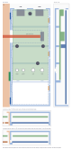

# piano

Open hardware modular hexagonal piano, inspired by the Lumatone.

It is built from identical tiles of 8 x 5 keys on a hex lattice. Each key is
an MX-style magnetic switch over a Hall-effect sensor, so the tile reads how
far every key is pressed. Tiles snap together edge to edge, in any
arrangement, and a short cable under each seam carries power and data. A hub
hangs on a free east edge, takes power in and gives USB out: MIDI and a
serial console with the raw key data.

## Status

| part | state |
|---|---|
| tile PCB | routed, DRC clean, not ordered yet. [`pcb/README.md`](pcb/README.md) lists what to verify before ordering |
| tile case | printed once (2026-11-13): mostly good, but the tray warps a little when the bottom cover goes in. The cover and board need about 1 mm more room; not changed yet |
| hub | circuit, schematic and board done ([`hub/`](hub/)): routed, DRC clean, not reviewed by a person and not ordered. Its case is designed with the room the tile's print asked for, and its fits are checked on the solids; not printed |
| firmware | tile and hub programs written and tested on a PC, never run on hardware: no board exists yet. Every tile and the hub take new programs through the hub's USB, also only on a PC so far. [`firmware/README.md`](firmware/README.md) |

## Where things are

| file | what |
|---|---|
| `tilegeom.py` | every dimension the board and the case share. Run it to check them |
| `tile_circuit.py` | the tile's circuit as data |
| `gen_lib.py`, `gen_sch.py`, `gen_pcb.py` | make the KiCad library, schematic and (once) the board |
| `route_board.py`, `pcbroute.py` | the board's routing as a script |
| `pcb/` | the KiCad project, and its README with the pin map for the firmware |
| `gen_case.py` | builds the printed case from `tilegeom.py` |
| `hub_circuit.py`, `gen_hub_lib.py`, `gen_hub_sch.py` | the hub's circuit as data, its KiCad library and schematic |
| `hubgeom.py`, `gen_hub_pcb.py`, `route_hub.py` | the hub board's dimensions, the placement of its parts, and its routing as a script |
| `hub/` | the hub's KiCad project |
| `gen_hub_case.py` | builds the hub's printed case from `hubgeom.py` |
| `firmware/` | the tile's and the hub's programs, the bootloader, their tests, and the scripts that put programs on every tile and the hub through the hub |
| `cad/` | the output of both case scripts: STLs ready to print, and three drawings |
| `HE60_NOTES.md` | notes on the sensing chain (sections 1 to 5) |

`TILE95.md`, `COST_ESTIMATE.md`, `gen_tile.py`, `gen_hex_board.py`,
`bom_model.py` and `kicad/` belong to earlier designs and contradict this one.

## The case

A printed tray (key plate, ribs, walls) and a printed bottom cover per tile.
No screws.

- **PCB:** drops into the tray from below. The switch pegs locate it.
- **Cover:** tuck its W edge over the lip on the W wall, then press its E edge
  down until the two catch beams click over the bumps on the E wall. Posts on
  the cover press the PCB against the ribs. To open it, pry a beam's tip out
  at its notch in the E wall, beside the E cable channel.
- **Tile to tile:** dovetail rails on a tile's E and N walls run in slots in
  the next tile's W and S walls. One snap latch per seam stops the tile
  lifting off again.
- **Cables:** at every port the cover and both walls are cut away, so the
  cable lies in an open channel from one tile's header to the next one's. It
  goes in from underneath, with the covers on.


### Putting tiles together

1. Start with the south-west tile, keys up, on a table.
2. Lower each further tile straight down beside it: its W and S slots slide
   over the rails of the tiles already there, and the latches click. Tiles
   only go together downward, never sideways.
3. Work outward to the north and east. A tile cannot be lowered into a place
   that already has a tile to its north or east.
4. Turn the keyboard over and plug a 50 mm JST GH 6-pin cable across each
   seam ([`pcb/README.md`](pcb/README.md) says how to measure the 50 mm).
   Either way round works.

To take it apart, unplug the cables and pull tiles straight up, starting at
the north-east. A firm pull releases a latch.

The rails carry a tile's weight, the latches only hold it down. So lift an
assembly by its south-west tile or from underneath; lifted by another tile,
the ones south and west of it hang on their latches.

### The hub

The hub's case is a tray and a cover like a tile's, 45 x 109 mm. Its W wall
is a tile's W wall: two rail slots, a latch window and a cable channel. Its
N wall has the windows for the two USB-C sockets.



- **Where:** on the free E edge of any tile. Lower it onto that tile's rails
  as you would a tile. Nothing joins onto the hub, and the place north-east
  of its tile has to stay empty: a tile there would stand in front of the
  sockets.
- **Board:** drops into the tray from below. The N wall and six small nubs
  locate it.
- **Cover:** tuck its W edge over the lip, then press its E edge down past
  the three tabs in the E wall. To open it, reach into the cable channel
  and pull the cover's edge up there; the tabs give way.
- **Cable:** the same 50 mm cable, from the hub's header to the tile's E
  header, in the channel under the seam.

This case has what the first tile print asked for. The cover stands 1 mm off
every wall, except for six ears 8 mm long: three on the W lip, three on the
tabs' bumps. The board stands 1 mm or more off the W and E walls and the rib
south of it, except at the nubs. The tabs are strips cut free of the E wall,
so they bend and the wall does not. The tile's own case does not have this
yet.

### Printing

`cad/` holds the parts in their print orientation: the tray upside down
(plate on the bed), the cover with its posts up. Print without support. One
tile's tray is 168 x 134 mm.

1. **`plate_test.stl`**, a 1.5 mm plate. Check that switches clip in, measure
   the two spans `gen_case.py` prints, and pass their ratio as `--xy-scale` if
   your printer shrinks.
2. **The coupons:** `coupon_tray.stl` twice, `coupon_cover.stl` and
   `coupon_pcb_dummy.stl` once. A coupon is a 2 x 4-key tile with every snap
   feature of the full one. Check the cover's catch on one, then join the two
   trays E to W and N to S.
3. **`tray.stl`, `cover.stl`** and, until boards exist, **`pcb_dummy.stl`**:
   a plastic stand-in with the board's outline, thickness and peg holes.

4. **The hub:** `hub_tray.stl`, `hub_cover.stl` and, until a board exists,
   `hub_pcb_dummy.stl`, which also has blocks where the two sockets and the
   cable header are. Try it on a full tray: a coupon has a rail where the
   hub has wall.

If a fit is off, change the number in `tilegeom.py` and run `gen_case.py`
again:

| symptom | constant |
|---|---|
| rails too tight or too loose in their slots | `RAIL_CLEAR` (0.15 mm) |
| latch lets go too easily, or will not let go | `LATCH_ANGLE` (50 degrees; higher holds harder) |
| latch does not click in | `LATCH_BITE` (0.6 mm), `LATCH_PLAY` (0.2 mm) |

`LIP_W` and `CATCH_D` must stay as they are: the board's outline is built on
them.

The hub has its own numbers in `hubgeom.py`, for `gen_hub_case.py`:

| symptom | constant |
|---|---|
| cover rattles sideways, or is hard to get in | `EAR_CLEAR` (0.2 mm; the script takes 0.1 to 0.25) |
| board rattles, or will not go in | `NUB_CLEAR` (0.3 mm), `NUB_W` (3 mm) |
| cover bulges, or the board is loose under it | `POST_PRELOAD` (0.1 mm) |
| tabs too stiff or too weak | `TAB_W` (8 mm; narrower is softer) |

Not yet tried in plastic, so expect a round or two on the coupons. Known
soft spots:

- The latch beams stand upright on the bed and bend across their layers,
  the weak direction. They strain 0.7 %, which PLA should take; PETG is
  the safer choice.
- The W lip is a 1.5 mm ledge with nothing under it. Its underside, which
  the cover rests on, will come out rough.
- The dovetails' sharp edges print rounded, which loosens them slightly.
- The hub's tabs also bend across their layers (0.8 % strain), and the
  wall over each USB-C window is a 14 mm bridge.

### Building the case files

```
python3 tilegeom.py     # check the geometry
python3 gen_case.py     # check the fits on the solids, write cad/
python3 hubgeom.py      # the same two steps for the hub
python3 gen_hub_case.py
```

`gen_case.py` needs `manifold3d` and `numpy`. It refuses to write anything
unless the solids show that neighbouring tiles clear each other, that a tile
can be lowered onto its neighbours' rails, that the latches and dovetails
then hold it, and that the cover and the PCB fit. `gen_hub_case.py` does the
same for the hub: its board and cover fit and are held, a USB-C plug fits
each window, and the hub can be lowered onto a tile's E edge, is held there,
leaves the cable's way open and clears the tiles around it.
